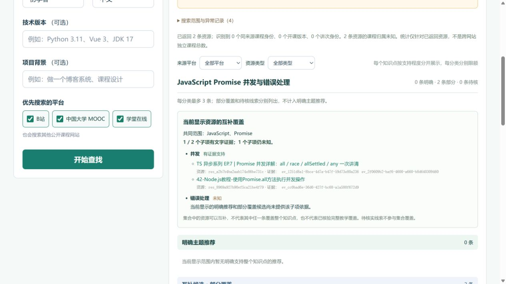

# v7：证据分区、互补覆盖与隔离恢复验收

2026-10-14。已完成代码修正、保存证据回归、5题真实联网复核、真实浏览器展示和隔离进程恢复验收。**B站/MOOC的实际搜索已经执行，但平台详情、自动目录提取和播放仍未验收通过。** 搜索结果的标题/摘要支持、完整教学覆盖、目录、播放是不同结论。

本次在修改前归档了已交付v6源码和报告，原始历史文件保留。8000主服务仍运行v6，进程身份及原 `frontend/dist` 未变。新版本的只读验收页面在18007；它使用独立SQLite副本，禁止新建检索任务。

- [本次真实Promise结果](http://127.0.0.1:18007/?job=4e769651-0d15-4396-b06e-bc4dfb750d2b)
- [预约直播待核卡片（保存的真实证据）](http://127.0.0.1:18007/?job=f02e91e3-8adb-4ded-903f-df14809e056f)
- [明确标为模拟来源的互补筛选示例](http://127.0.0.1:18007/?job=07b31254-6859-475d-929f-4d25ed9f88df)

## 产品行为

接口和页面都有“明确主题推荐”“互补候选·部分覆盖”“待核实线索”三个分区。卡片正文直接显示状态、具体原因与对应证据ID，无须先展开来源。平台筛选不能把预约预告等待核线索升级为明确推荐。

四条指定弱证据均留在待核区：D06比较Flexbox的Subgrid视频、D13将匿名函数称作闭包但缺少词法作用域/捕获依据的视频、H09预约直播、H16只在外链出现旋转词的四元数视频。规则依据自身观察内容，不硬编码案例ID、视频ID或URL；明确比较教学、真实应用和明确回放有正例保护。

复合知识点按可识别的共同技术上下文及显式子项判断。每条候选分别列出支持与未知；先修、相关推荐、外链或另一条资源不能补齐自身教学依据。标准Promise API可以帮助确认JavaScript/Promise归属，不能仅凭API名宣称并发或错误处理教学。集合覆盖只计算当前展示、去重、分类限额和筛选后的资源。

保存的40题最终回归：默认分区共 **108条直接支持、3条部分覆盖、4条待核**，两个负对照仍全部为0。首次回放发现的“文件的读写”及标准数据库范式误降已修复；子项借用先修内容的反例修复后保留真实并发部分覆盖。首轮和最终结果均保留，未修改原始来源证据。

## 真实联网范围与结果

本次只复核D06、D13、H06、H09、H16，沿用原请求及来源，不追加40题联网，不添加引擎、权限或凭据。五题已用于开发，不能称未见过的留出样本。

| 实际执行 | 数量与边界 |
|---|---|
| 逻辑查询 | 25条，23 completed、2 failed |
| 应用到SearXNG的HTTP | 44次，上限60 |
| 来源HTTP | 4次：MIT robots及sitemap、Douyin robots及详情；上限20 |
| DoH HTTP | 8次，上限40 |
| B站定向查询 | 5条逻辑查询、7次SearXNG HTTP |
| MOOC定向查询 | 5条逻辑查询、10次SearXNG HTTP |
| 自动目录 / 播放 | 0 / 0，未验收通过 |

账本56次HTTP均返回200，但SearX响应仍含D06的两次timeout和两次unknown上游故障。全类请求起始间隔至少2.001166秒、观察并发峰值1；SearX内部物理上游请求数unknown。进度计数46还包含2次官方发现请求；8次详情处理中的7次是策略停止，仅1次实际详情请求，不能混算成成功抓取8个页面。

| 题目 | 默认直接支持 / 部分 / 待核 | 结果解释 |
|---|---|---|
| D06 CSS Flexbox 对齐 | 0 / 0 / 0 | 本次上游故障、泛CSS结果与域不匹配，不能推断无课程 |
| D13 JavaScript closures | 3 / 0 / 0 | 搜索证据支持；详情与播放未核验 |
| H06 JavaScript Promise 并发与错误处理 | 0 / 2 / 0 | 两条均只支持并发，错误处理unknown，集合1/2 |
| H09 地理坐标与投影坐标转换 | 3 / 0 / 0 | Douyin详情需要JS；其他详情按既有策略停止 |
| H16 quaternion rotations | 3 / 0 / 1 | 泛四元数外链线索仍待核 |

MOOC五题均无合格展示；其中H06和H09有选入的候选但主题证据不足，其他题还涉及零返回或域不匹配。**不能把零展示写成MOOC没有课程、限流或验证码。** B站/MOOC本轮没有直连平台详情或robots请求；站点限定的真实搜索不等于平台目录验收。

联网运行时源码冻结，原始记录未变。结束后为先修子项及两项误降做了最终语义修正，仅对同一次保存证据离线重评，未重复联网；最终五题分类和可见资源与原始联网结果相同。

详见 [真实请求审计](live-audit.md)、[原始冻结范围](live/frozen-scope.json)、[原始完成记录](live/finished.json)、[最终40题回归](offline-40-final/summary.json)、[同批实网证据最终重评](live-final-replay-v2/summary.json)。

## 浏览器与进程验证

真实浏览器已验证四条待核卡片的正文理由、证据ID及平台切换一致；模拟互补资源筛选前2/2，B站或MOOC单个平台均1/2，筛成空集0/2。模拟来源显式标记，不能当实网发现。真实H06页面显示1/2，错误处理仍未知。390×844移动视口没有横向溢出，控制台错误0；主题直接支持与播放unknown独立显示。

最终进程试验使用18127/18128、独立临时SQLite及本机模拟来源，外网请求0。先观察 **active 1 + queue 2** 同时满载，再取消活动和排队任务；溢出返回429及Retry-After。真实OS进程强杀后，worker PID **27624 → 50936**，同数据库恢复；原running/queued变为interrupted，原幂等键不重新执行，取消状态保留，新任务完成。

独立进程持久账本记录9次进入（provider 7、target 2），6次返回、3次断连，观察窗口内无重复尝试键。最终队列和active均0、测试端口无残留、临时库清理完成。运行前后23项源码hash不变；8000主服务PID、创建时间、命令与监听地址一致。这是容量2的本机恢复试验，不代表默认20容量压测、外部系统exactly-once或操作系统防火墙级隔离。

详见 [进程验收说明及保留失败](process-validation/README.md)、[run-6完整记录](process-validation/run-6/summary.json)、[浏览器验证](ui-final/verification.json)。run-1至run-4为工具/夹具假设失败；run-5功能通过但源码并行变化，不能作最终冻结验收；run-6全部门禁通过。

## 检查与交付文件

- `pytest tests`：**517 passed**，既有Starlette/httpx弃用提醒1项。
- `pytest backend/tests`：**119 passed + 26 subtests passed**。JUnit记为145个testcase，不能再把145与26相加。
- 前端纯逻辑：**7 passed**；TypeScript检查及独立目录构建通过。3个新增Playwright E2E未运行，实际浏览器验收采用CUA，不能把两者混报。
- 本次先保存v6源码108文件及报告326文件；旧文件逐项hash保持。主服务未重启，部署状态仍为v6，新源码与只读预览为v7。
- 初次全套测试的1处过时mock已修复，保留原失败XML。验证汇总脚本首次未识别Node的直接testcase形式，保留 `validation-attempt-1.json`；修正计数解析后重新核验。
- `live-final-replay`首份比较报告错误使用v6旧状态标签，结果及证据未受影响；保留该记录，最终使用 `live-final-replay-v2`，其旧状态来自原始match。

[最终机器核验](final-validation.json) 及 [SHA-256](final-validation.sha256) 冻结源码、报告与静态证据。运行中的只读预览SQLite、日志和SQLite sidecar不作为静态hash承诺；其来源副本、启动身份、接口记录及浏览器证据已单列。

[后端实现与规则边界](backend-implementation.md) · [v6归档清单](baseline-v6/manifest.json) · [主服务前态](main-preservation-before.json) · [主服务后态](main-preservation-after.json)
