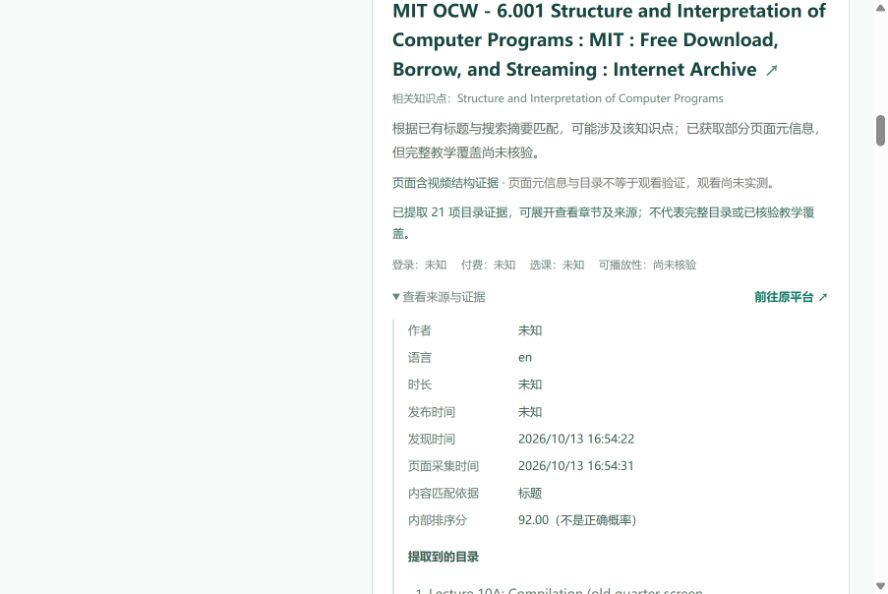
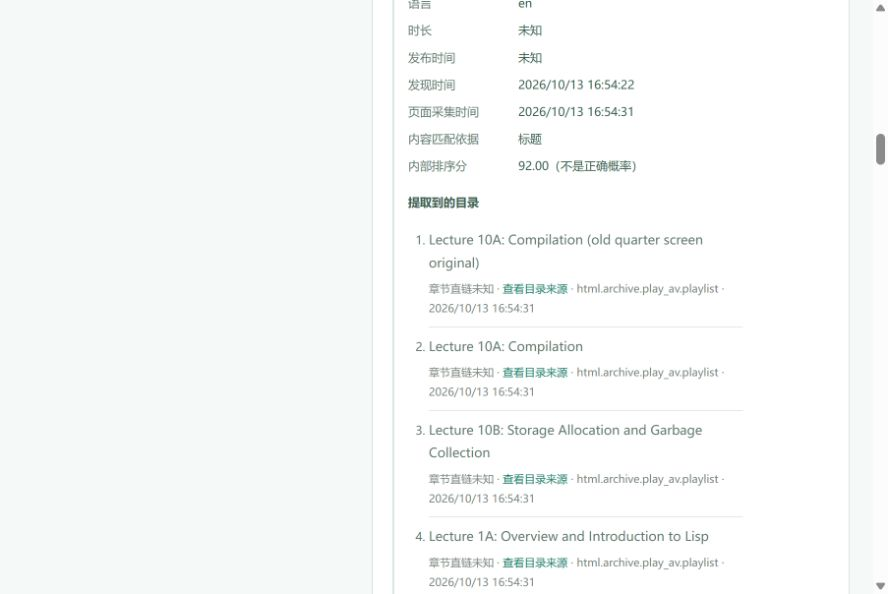

# 本轮补充实现与真实联网验收

> 后续平台路由修复、MOOC 入口、学堂新政策证据及单条实际播放抽查见 [2026-10-13 覆盖补充报告](coverage-followup-20261013.md)。以下保留为此前阶段记录。

日期：2026-10-13。范围：知识点到公开课程/视频发现、允许页面与目录提取、排序、证据展示。未增加付费服务、账号、凭证、视频下载或播放代理。

## 本轮结论

最初只有目录提取代码、没有通过应用搜索链路取得真实目录，不能称为目录功能已经端到端验收。本轮已补齐并真实验证：浏览器输入 → SearXNG 搜索发现 Archive 原平台链接 → HTTP 静态 HTML → 21 项真实视频目录 → 前端展开显示。另有独立 MIT 官方课程首页/视频目录验证，提取 20 个真实章节链接。完整平台验收仍未完成：中国大学 MOOC 与学堂在线本轮未被发现；实际观看尚未验证。

## 修复的实现问题

- 分离搜索类型依据、页面元信息、视频结构证据、真实视频目录与观看实测。普通 JSON-LD Course、Open Graph 视频标签、普通课程大纲都不能升级为页面视频已核验。
- 过滤文字文档冒充视频；英文技术名采用词法匹配，避免 Java/JavaScript、SQL/NoSQL 子串误配；先修要求不作为独立教学覆盖依据。
- 首轮公平搜索后详情补全与余下查询并行，共用网络并发及 40 页面预算；目录跟随也计入预算。缓存补全单列，任务截止取消在途工作。
- HTTP 搜索、重试、备用组均留真实执行记录；历史缓存请求与本次请求分开。服务 401/403 停止后续请求、429 暂停，上游验证码/拒绝访问的引擎停止对应路径。
- MIT OCW 可见同课程视频目录最多跟随一次；逐章保留来源与证据。没有时间戳依据时为 null。
- 前端显示章节列表、原始章节链接及真实证据；目录空列表不会被解释为来源没有目录。

## 来源规则与配置

本次核对 [B站用户协议](https://www.bilibili.com/blackboard/protocal/licence.html) 和 [YouTube Terms](https://www.youtube.com/static?template=terms) 后，直接自动抓取路径停止，并保留来源、日期和具体原因。YouTube 条款于后续复核中发现，早期探测记录保留，不用删除历史记录掩盖这一纠正。此后没有继续请求 YouTube 视频页。

本地 SearXNG 已只保留 `bing` 与 `duckduckgo videos` 独立搜索引擎。先前遇到 CAPTCHA 的一般 `duckduckgo`、Qwant 以及失败的 Sogou 没有为“通过验收”再次试探。YouTube/B站直接采集引擎已从配置删除，应用拒绝显式启用；知识点中的引擎切换操作符不会覆盖服务端选择。此配置不构成所有搜索服务长期可用的承诺。

MOOC/学堂在线自动采集许可范围尚未确认，保持 `policy_unreviewed`。robots 与站点规则、登录/验证码限制独立处理。没有放宽 SSRF、TLS、DNS 出口验证。

## 保留的前序联网记录

- `live-revision-20261013.json`：四个中文知识点、D3、英文及重复输入、无结果用例，35 个展示资源，目录为 0。一般搜索出现验证码，视频页面有超时、过大、JavaScript 等状态。该轮尚含后来停用的 YouTube 直接搜索引擎；不能作为最终配置验收。
- `searxng-d3-video-diagnostic-20261013.json`：独立引擎诊断找到了真实 D3 教学链接；诊断不等于应用最终流程已通过。
- `catalog-probe-mit-home-20261013.json`：独立 MIT 首页 → 视频目录 → 单章节元信息，20 章节及 HTML/哈希。未注入正式 SQLite、未预设课程库。

## 最后版本的验证

独立允许页面采集：`catalog-probe-mit-final-revision-20261013.json`，4 个请求均 HTTP 200（robots、课程首页、真实导航目录、首章页面），3 份原始 HTML 及 SHA-256 留存。20 个章节链接与逐章 JSON 证据匹配；所有时间点未知；课程与章节的页面视频结构各有独立证据。采集器前后代码哈希相同，未写正式 SQLite、未播放或下载视频。

浏览器验证路径：本地应用输入新的知识点 → 提交真实任务 → 查看终态/异常 → 核对可用原平台链接或明确无结果。独立 MIT 探测与此浏览器路径分开报告。

最终自动化与应用联网结果见下文“最终交付版本”。

## 最后浏览器复查发现的解析遗漏

`browser-live-before-archive-fix-20261013.json` 来自实际浏览器提交，没有接口替身。D3 与 SICP 共返回 8 个展示资源，任务 completed，4 次真实搜索请求。打开从结果卡片读取的 Archive 原平台链接后，确实看到 21 个播放列表条目，应用当时只有简介、目录为空。这属于解析器覆盖不足，不应归咎于外部网络；原页面截图和该版本结果完整保留。

`live-final-revision-20261013.json` 是这一修复前的全量记录：32 次实际 HTTP 搜索、29 个展示资源、0 个目录。中文四组分别 5/3/5/5 项，D3 1 项，英文两组各 5 项。B站搜索发现已验证，MOOC/学堂未发现；不覆盖稍后的解析器修复。

## 最终交付版本

最终代码冻结后：127 个后端测试、26 个子测试通过（`backend-tests-delivery.xml`）；14 个前端流程测试通过（`frontend/e2e-results-delivery.json`），生产构建及 Compose 配置检查通过。保留 1 个依赖侧 TestClient 弃用提醒，没有为消除提示擅自改锁定依赖。

最后两处相关性回归也已验证：Python3 等完整版本拼写匹配 Python，但 JavaScript 不匹配 Java、NoSQL 不匹配 SQL；同句明确教学内容与先修子句分开判断，纯先修反例仍被过滤。

### 无替身浏览器流程

[浏览器完整记录](browser-live-delivery-20261013.json)，任务 `59086843-e7f3-4f56-b3b4-07f2a4c36d43`，2026-10-13 16:54:17–16:54:31（北京时间）。输入 D3.js enter update exit 与 Structure and Interpretation of Computer Programs。4 次真实 HTTP 搜索，0 缓存命中，返回 3 + 5 项；实际 HTTP 获取 Archive 页面后展示 21 项目录，逐章 JSON 证据校验通过。

条目保留原顺序和重复版本（首项是同一讲的旧版）；没有猜造独立章节页面或时间偏移，因此 chapter.url / start_seconds / end_seconds 全为 null，每条可回到实际目录来源页。公开 HTML 可安全读取，不使用后端浏览器回退或新的私有接口。

| UI 检查 | 结论 |
| --- | --- |
| 页面身份 / 非空 / 无框架错误页 | 通过，本地生产构建 |
| 实际表单提交与终态 | 通过，completed，真实查询计数 |
| 控制台 | 无 error/warn |
| 目录展开与来源 | 通过，21 项标题及来源；未知直链如实标明 |
| 原平台入口 | 卡片 href 与已打开核对的 Archive 原页面一致 |
| 实际播放 | 未执行，unknown |

浏览器使用 Codex IAB 的默认 888×594 视口；Browser plugin not available，离线前端测试使用已有 Playwright / Microsoft Edge，覆盖桌面与移动布局。真实浏览器验收使用 CUA，无 API 路由替身。点击新窗口链接时 IAB 未登记弹出标签，原平台核对使用从卡片读取的同一 href 显式打开；没有把这一工具差异冒充自动跳转成功。

### 最终完整真实用例

[完整报告](live-delivery-20261013.json)，前后源代码和验收脚本哈希一致。此脚本新增了实际浏览器中发现目录的输入作为回归用例，没有预置 URL 或候选。

| 用例 | 终态 | 展示数量 | 本次搜索 HTTP |
| --- | --- | --- | --- |
| 四个中文知识点 | completed | 5 / 3 / 5 / 5 | 20 |
| D3.js 数据连接 enter update exit | completed | 3 | 5 |
| 英文两知识点与重复输入 | completed | 5 / 5（重复输入合并） | 4 |
| 无匹配随机知识点 | completed | 0 | 2 |
| 浏览器发现课程的回归输入 | completed | 3 / 5 | 0（复用本轮浏览器刚取得的真实缓存） |

脚本合计 31 次真实 HTTP 搜索、4 次搜索缓存命中；此前同版浏览器独立产生 4 次真实搜索，所以本轮两份最终验收共 35 次真实搜索请求。脚本去重后展示 38 个资源：B站 20、其他网站 18。37 项只有视频搜索发现证据，1 项有页面视频结构和 21 项目录；实际播放验证为 0。普通页面元信息没有被计入视频结构验证。

指定中文知识点、D3、英文、重复输入、正常无结果、真实搜索来源、B站发现、页面视频结构、应用目录、无虚构播放声称、代码未变检查均通过。另以实际 TCP 连接拒绝验证网络故障，隔离于正式 SQLite；这不是外部供应商实际宕机的证据。

### 剩余范围与继续条件

- **完整真实联网验收未完成**：`icourse163_discovered=false`，`xuetangx_discovered=false`。本轮所选一般搜索引擎未返回这两个平台的有效候选；前端不会用预设课程补齐。需要可用且能返回相应索引的已配置搜索服务，再执行定向发现测试。没有切换到未配置的付费服务。
- B站与 YouTube 的搜索发现不等于详情可抓取；本项目没有所需直接采集许可，目录不会绕过站点规则补全。MOOC/学堂的自动采集许可范围仍待核对。
- MIT 和 Archive 的有限公开结构已验证；其他网站、动态目录、单视频时间轴不保证可提取。没有通用字幕/视频内容分析，没有学生账号播放测试。
- Tavily/可选模型没有配置密钥，保留接口与离线回归边界；不声称这些外部服务已联网可用。

源码、缓存版本和字段契约已冻结；原失败和修复前报告全部保留。应用继续在 [本地查看最终目录](http://127.0.0.1:8000/?job=59086843-e7f3-4f56-b3b4-07f2a4c36d43) 运行。

