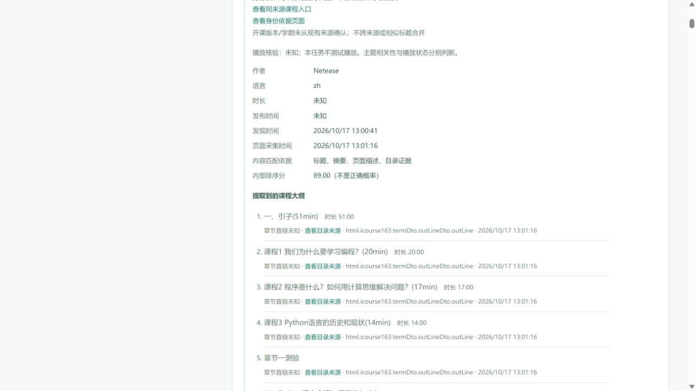

# MOOC公开课程读取与真实联网验收（2026-10-17）

**MOOC公开课程页→后台目录→实际页面展示的链路已打通。** 此次改动不再把“自动聚合许可范围未确认”当作平台明确禁止。最终任务从真实表单输入知识点，经真实搜索发现课程，再匿名请求源站HTML；保存的HTML只作事后证据，没有回放到该任务中。

当前可查看：[修复版实际结果](http://127.0.0.1:18021/?job=f2930cbf-37cd-424e-8036-fb73631573f1)。整任务状态仍为 `partial`，不能表述为全部候选、平台或视频播放验收通过。

## 最终联网结果

输入 `Python 语言基础`，初学者、中文、优先中国大学MOOC。新空数据库，无种子、旧搜索缓存、页面缓存或直接课程URL注入。任务 `f2930cbf-37cd-424e-8036-fb73631573f1`：4个查询完成，8次真实搜索/官方发现请求，18条候选、17条去重资源，12次详情流程，搜索和详情缓存命中均为0。证据目录：[最终任务](revisions/outline-boundary-repair/jobs/f2930cbf-37cd-424e-8036-fb73631573f1/)。

6个MOOC课程页面均实际返回HTTP 200；其中5门返回共361项公开大纲，一门公开大纲为空。独立核对原始响应中的大纲字符串、数据库的逐项标题/顺序和来源证据，结果一致。

| 真实课程页 | 本次大纲项数 | 验收情况 |
|---|---:|---|
| [Python语言基础与应用](https://www.icourse163.org/course/PKU-1003479006) | 84 | 原始响应、数据库、实际界面逐项一致 |
| [零基础学Python语言CAP](https://www.icourse163.org/course/BIT-1002058035) | 16 | 原始响应、数据库、实际界面逐项一致 |
| [Python语言程序设计基础](https://www.icourse163.org/course/NJUPT-1003215002) | 0 | 本次公开HTML的大纲为空，界面未捏造目录 |
| [用Python学人工智能](https://www.icourse163.org/course/-1462245166) | 45 | 原始响应、数据库、实际界面逐项一致 |
| [用Python玩转数据](https://www.icourse163.org/course/NJU-1001571005) | 94 | 原始响应、数据库、实际界面逐项一致 |
| [数据结构与算法Python版](https://www.icourse163.org/course/PKU-1206307812) | 122 | 新HTTP响应与数据库全量一致，修复100项截断；当前每平台5条展示上限使该卡片未进入结果区 |

最后一门课程本次响应139602字节，SHA256 `0d0735ea1d7952f9652b545832e1a7454551e6a84e2623b611c82c568a5ab422`；末项为“第十二周作业”。本次真实页面展示了5门课程中的4门共239项大纲，逐项文字和来源链接均与本机API一致；浏览器无错误/警告、无横向溢出。详见 [后台独立核验](revisions/outline-boundary-repair/verification.md)、[逐项核验JSON](revisions/outline-boundary-repair/verification.json)、[界面核验](revisions/outline-boundary-repair/ui-verification.json)。



`partial` 的具体边界：本轮没有失败查询或上游超时；一次Bing返回内容缺少知识点信号，独立来源回退后查询完成，`no_topic_signal` 仍作为范围警告保留。既有服务会把任一上游警告统一显示为“部分搜索或官方发现来源未完成查询”，该泛化文案不等于本轮网络失败。12页详情预算已达到，11个候选仍只有搜索证据，3个类型未知的候选未作为学习资源展示。MIT官方发现得到0候选，不能据此推断站点没有相关课程。

## 实际修复

- 仅放行官方HTTPS `/course/<机构>-<数字编号>` 及经核对的单个数字 `tid` 参数，保留身份参数；每次执行robots、DNS/公网、重定向、访问拒绝及预算检查。跨域/学习页/API重定向在DNS前停止，宽泛允许名单也不能扩大范围。
- 直接读取同一HTTP响应自带的 `window.termDto.outLineDto.outLine` 字面量。旧代码移除script节点后遗漏了大纲；新解析不执行JavaScript、不调私有API，并核对课程ID和指定学期ID。
- 修复适配器及统一目录写入两处100项截断。MOOC最多完整保留500项；超过上限时不给出截断列表，明确记录 `catalog_limit_exceeded`，同时阻止较短DOM/JSON-LD目录混入并清除目录证据。
- 提取器缓存版本升为10，使旧的空目录或100项目录缓存失效。前端新增公开页范围说明、超限说明及对应来源证据。

大纲包括章节、课时、测验和作业，**361项大纲不是361个可播放视频**。没有返回的视频直链、时间轴和播放可用性保持未知；未验证登录、付费、选课或教师身份。页面 `meta.author=Netease` 仅是网站元信息，不作为教师核验结论。

## MOOC范围与B站限制依据

[MOOC官方协议](https://www.icourse163.org/topics/mooc_privacy_service/)本次仍为2021-07-16版本：3.1区分课程信息浏览与登录学习；5.2.7涉及第三方工具/服务接入，但未明确列举匿名公开课程HTML读取，不能扩大成明确全面禁止；8.6内容再使用限制仍保留。匿名robots请求实际返回404，没有给出Disallow规则，也不代表平台授予广泛自动聚合许可。具体读取范围是受边界约束的实现判断，书面聚合授权仍为unknown。[范围复核和HTTP证据](scope-review.md)。

[B站官方协议](https://www.bilibili.com/blackboard/protocal/licence.html)5.6(3)明确要求自动程序/脚本获取平台服务、内容或数据前取得明确书面许可；1.5涵盖未注册用户。项目未取得该许可，继续在课程页请求前停止，保留搜索发现及条款链接。条款版本2025-04-30、生效2025-05-07，核对日期2026-10-17。原文与截图保持在[前阶段条款证据](../platform-live-chain-20261017/README.md)，最终任务没有B站课程页HTTP请求。

不接入MOOC登录学习、报名、播放、私有接口或页面脚本执行。遇到401/403/429、验证码、登录/付费提示及robots拒绝均原样停止，未使用账号、Cookie、验证码处理或访问限制规避。

## 测试、历史失败和封存

- 后端完整测试813项通过：[全套JUnit](backend-tests-final.xml)。最后修复混合目录上限后，138项相关回归通过，包含2个新增混合来源用例：[最终变更回归](final-changed-tests.xml)。两次覆盖合计815个不同用例，不能把重叠用例相加。前端TypeScript/Vite构建通过。
- 首轮真实任务 `1e976e58-f094-489b-82db-c43d35bf61e5` 的6个课程页、339项目录和“100/122截断”失败原样保留：[首轮独立报告](verification.md)。首轮另有一次上游超时；它不是最终任务的状态。
- 中间 `outline-length-repair` 服务只启动、没有提交任务；混合来源边界修复后使用另一个空库和18021端口，避免与旧服务共用数据库。自动审批曾拒绝停止旧服务的命令，原服务保留；这没有导致追加搜索或覆盖旧证据。
- 最终代码与构建的哈希对应最终服务启动清单，`.env`未修改；前阶段报告按冻结哈希验证未变。最终代码、SQLite一致性备份、原始响应、UI截图和全部测试记录见 [稳定封存清单](final-validation-stable.json)。活动库/WAL和服务日志不作为静态封存文件。首次清单误包含备份连接关闭后消失的两个临时WAL/SHM文件，原清单保留；稳定清单排除临时文件，数据库主体与其他证据哈希均未因此改变。

本机18021服务已保持运行。今后服务退出后，可恢复该已有证据库：

```powershell
cd D:\项目制知识引导小精灵
.\.venv\Scripts\python.exe scripts/serve_mooc_public_live.py --revision outline-boundary-repair --resume
```

不加 `--resume` 会拒绝复用已有库，防止把恢复查看误记为新空库验收。常规应用仍可通过项目原有启动入口运行，本次修复在正式后端和前端代码中。
