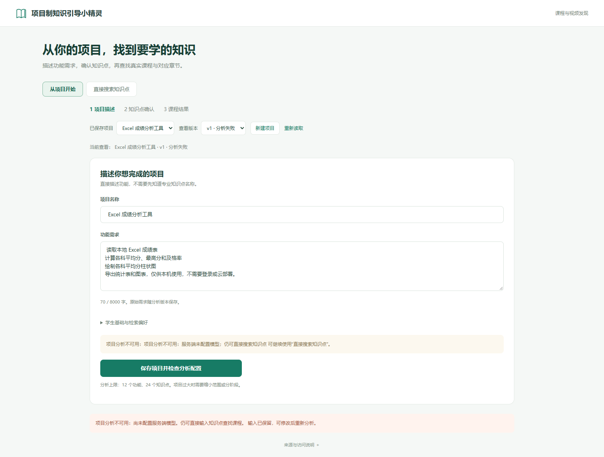
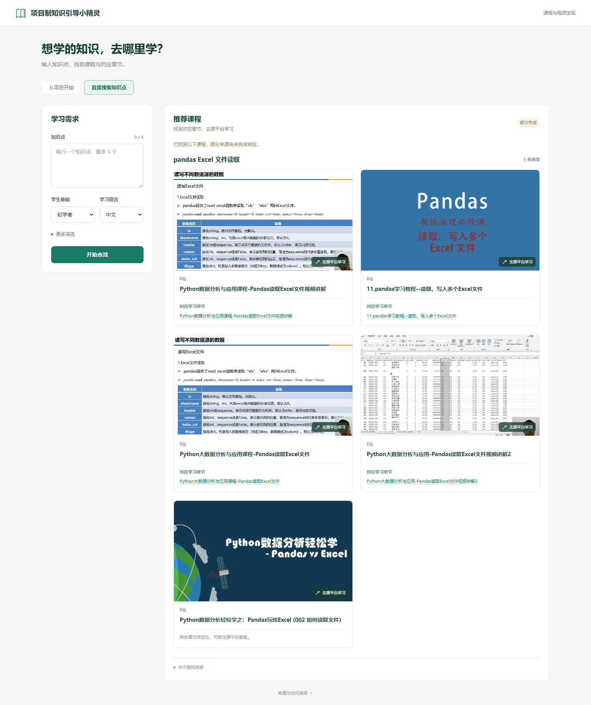

# 项目需求分析与知识点确认 v1：实施与验收

日期：2026-10-17（Asia/Shanghai）。检查时工作区干净，HEAD 为用户参考提交 `d4beb5df724d57f7b6e9dde2bb088e7a71f26fc6`。在实际最新代码上增量开发，没有回退、重写抓取器或修改本机 `.env`。

## 交付结论

| 分类 | 本轮结果 |
| --- | --- |
| 代码实现 | 已实现项目输入、独立 AI 分析模块、严格校验、学生编辑确认、依赖冲突处理、项目级预算与分批、版本持久化、结果分组、共享任务安全取消 |
| 离线测试 | 最终后端 **1104 passed + 26 subtests passed**；前端逻辑 **34/34**；浏览器 **37/37**，0 skipped、0 flaky；TypeScript/Vite 构建通过 |
| 真实模型联调 | **未完成**。实际 `LLM_PROVIDER=none`、模型名为空、未配置密钥；没有调用其它凭据或用 Mock 冒充分析成功 |
| 真实搜课联调 | **已执行一条新的手动知识点搜索**：12 次搜索请求、7 个抓取成功的课程/视频详情、7 条有证据的目录记录，界面显示 5 条推荐；任务为 partial |
| 完整真实项目链路 | **未完成**。已实际验证项目输入保存、未配置模型失败、刷新恢复及未确认不能检索；无法完成真实 AI 输出后的学生确认和项目检索闭环 |

最终代码预览：[项目页](http://127.0.0.1:18118/?project=6242b345-f7a4-4e4d-a4f5-babb3dc8a585&version=1)、[本轮真实搜课结果](http://127.0.0.1:18118/?job=2c4296e9-e17e-44e6-a45a-6b0063541f23)。只监听 `127.0.0.1`。18118 使用本轮 18117 实测库的独立一致性副本；这些结果仍属于原始实测任务，**不是另一次新搜索**。

自动审批拒绝停止并重启本轮 18117 验收进程，返回原因仅为 `blocked by policy`。原进程保留；18118 使用独立副本和最终代码，未共用正在写入的 SQLite 文件。原有 18102 服务和搜索容器未停止。

## 实现与数据

- 原始项目名称、自然语言需求与检索偏好原样保留。重新分析或保存实质修改生成新版本；不按相同标题继承掌握状态或资源映射。
- 分析使用独立系统提示词 `project-analysis-v1`；只复用现有 JSON HTTP 通信与服务端配置，课程扩词、分类和重排任务语义不变。每次调用有 60 秒总期限；结构错误至多修正一次。输出最多 12 个功能、24 个知识点，超过上限明确失败并要求缩小范围。
- Pydantic 严格校验类型、长度、数量、唯一 ID/名称、功能引用、前置引用、无环和学习顺序；每个功能必须有学习用途或“不需要新增学习”的解释。分析禁止课程网址与章节对象，用户输入放在数据消息中，不提供工具或配置权限。
- 按功能展示，同一项目知识点共享状态。支持需要学习/已经掌握/暂时跳过、改名、增删、目标、顺序、功能关联和前置关系修改。跳过前置需显式确认影响。全部已掌握或跳过时只保存，不创建空任务。
- 服务端检查确认快照，只把 `learn` 送给原 `JobService`。容量按 `min(5,运行配置上限)` 分批。确认前预留所有批次的完整单任务预算；超预算整体拒绝，不截断选择。重复点击和刷新沿用持久化批次与幂等键。
- 所有批次经过同一个全局队列、限流和来源暂停。失败、尚未执行、无结果、部分完成分别保留。编辑后旧结果继续标记原版本。
- `job_consumers` 记录项目批次、手动入口与迁移前未知使用关系。取消先停止后续批次，仅取消独占任务，其他使用者关联的任务继续。取消清理期间新的手动检索不会复用正在取消的任务。
- 复用现有 `ResourceCard`、封面、章节匹配和证据逻辑；不补造未抓取章节。不新增账号、部署、视频下载或代理播放功能。

新增接口、请求字段、配置和数据库表详见 [API 与运行说明](../../docs/project-analysis-v1.md)。原四个 `/api/search-jobs` 接口保持兼容。

实际旧库迁移验证使用 `data/discovery.sqlite3` 的只读 SQLite backup：原 8 张表结构及完整行哈希均相同，`integrity_check=ok`，外键错误 0。包含 35 个旧任务、70 个旧检索知识点、925 条资源记录、1761 条证据。生产源库未用于迁移写入。[迁移核验 JSON](migration/verification.json)

## 实际测试记录

| 执行项 | 基线 | 完成后 | 证据 |
| --- | --- | --- | --- |
| Python 完整套件 `tests backend/tests` | 1000 passed + 26 subtests | 1104 passed + 26 subtests | [基线](baseline-backend.xml)、[最终](accepted-backend.xml) |
| Node 前端逻辑测试 | 34 passed | 34 passed | `baseline-frontend.log`、`accepted-frontend.log` |
| TypeScript/Vite 构建 | 通过 | 通过 | `baseline-build.log`、`accepted-build.log` |
| Microsoft Edge Playwright | 28 passed / 1 failed | 37 passed，0 skipped/flaky | [基线](baseline-e2e.json)、[最终](final-frontend-e2e.json) |
| 项目新增后端专项 | 不存在 | 104 passed（已包含在最终1104中） | [专项](final-project-boundaries.xml) |
| 数据库兼容 | 原实际旧库副本 | 8 原表零行/结构变化 | [核验](migration/verification.json) |

基线浏览器失败是已有缺陷：首次 `results` 响应被延迟时，前端等待整轮轮询完成才显示取消按钮。增加“已知 jobId、尚未读到 job”的取消入口后，同一原测试通过；没有改写原测试来规避失败。原始失败截图和 trace 保留在 `baseline-e2e-artifacts/`。

最终后端仅有既有的 Starlette TestClient/httpx 弃用警告。中间阶段测试文件保留，不能把多轮重复用例相加。

用户随后要求截图中的四项仅保留“学习语言”。已在 `ProjectFlow.tsx` 移除学生基础、技术版本、补充项目背景三个项目输入控件；学习语言独占一行，平台偏好保留，直接搜课表单和后端字段不变。此次界面调整后再次完成构建及原有项目 E2E **8/8**；后端未改，未重复运行后端套件。当前 18118 浏览器已实际刷新并展开核查，仅有学习语言与平台偏好；没有再次分析或发起搜课。[构建日志](language-only-ui/build.log)、[8 项测试](language-only-ui/project-e2e.json)、[当前浏览器核查](language-only-ui/browser-check.json)、[最新截图](language-only-ui/current-browser.png)。上一版哈希清单原样保存在 `language-only-ui/previous-delivery-manifest.json`，当前清单包含本次更新；18118 直接提供新构建的静态文件，无需重启后端。

新增测试覆盖：

| 要求 | 对应用例文件 |
| --- | --- |
| 正常、空/空白/过长/模糊需求；模型未配、超时、HTTP失败、非法JSON、非法字段、修正上限、输出超限、注入数据隔离 | `tests/test_project_analysis.py` |
| 引用不存在、重复ID/名称、环、自引用、无功能用途、前置顺序；ASP.NET/Socket.IO 技术名不误判链接 | `tests/test_project_analysis.py` |
| 编辑/新增/删除/共享状态，未确认拒绝，mastered/skip排除，跳过直接/传递前置，全部无需学习 | `tests/test_projects.py` |
| 7点按5+2分批无遗漏、运行容量低于5、总请求/详情/批次/时间预算、限流、部分失败、刷新/重启、提交后映射前中断 | `tests/test_projects.py` |
| 历史版本隔离、旧确认不能启动新修改，独占/共享/手动任务取消，运行配置收紧，长背景摘要 | `tests/test_projects.py` |
| 取消清理并发、legacy归属迁移、幂等消费者恢复、状态不假报完成、原输入不覆盖配置 | `tests/test_project_boundaries.py` |
| 确认交互、共享状态、编辑、跳过前置、7点、预算、刷新、取消、历史结果、未配置模型、移动端 | `frontend/tests/project.spec.ts`（8条，明确离线Mock） |
| 原手动搜索、真实章节数据展示规则、异常与取消等旧功能 | 原测试全部保留，`frontend/tests/search.spec.ts` 29条通过 |

没有把 Mock 输出的教学相关性当作真实模型的内容审查。Excel、社团报名、问卷分析三例的真实模型输出相关性、遗漏和过度设计审查，仍待服务端模型配置后完成。

## 本轮真实请求与页面验收

真实输入项目为“Excel 成绩分析工具”：本地读取 Excel、均值/最高分/及格率、柱状图、导出，不要求登录或云部署。项目 ID `6242b345-f7a4-4e4d-a4f5-babb3dc8a585`，原始前后空格及换行逐字核对一致。

真实模型配置缺失后，项目版本 v1 为 `analysis_failed/unconfigured`，`analysis=null`。刷新仍可恢复原输入。直接请求未确认版本检索返回 HTTP 409。该项目没有任何检索批次，也没有假分析结果。[原始项目记录](live/unconfigured-project.json)、[拒绝检索响应](live/unconfirmed-search.json)

随后在实际页面切换到“直接搜索知识点”，输入 `pandas Excel 文件读取`。独立空库，没有手工候选、固定课程URL、旧任务或缓存注入。任务 `2c4296e9-e17e-44e6-a45a-6b0063541f23` 的结果：

- 6 条计划查询：5 条完成，1 条到达预算未执行完；共12次搜索/官方发现请求。DuckDuckGo Videos 曾超时，部分结果缺少主题信号；保留来源警告。
- 22 条候选、17 个去重资源；7 个详情读取成功，7 条目录记录均有对应 catalog 证据，标题、链接、时长逐字段一致；默认展示5条推荐。
- 搜索缓存命中0、详情缓存命中0。HTTP审计记录响应正文哈希、状态、URL与字节数，不保存原始HTML正文；目录核对是数据库字段与本轮来源证据的一致性检查，不声称重新独立解析了保存HTML。
- 最终 `partial`；没有为不足范围补造结果。未验证完整视频播放、教学质量、整门课程覆盖或全平台覆盖。

证据：[汇总](live/acceptance-summary.json)、[真实任务](live/manual-job.json)、[真实结果](live/manual-results.json)、[目录账本](live/chapter-ledger.json)、[HTTP事件](live/jobs/2c4296e9-e17e-44e6-a45a-6b0063541f23/events.jsonl)、[审计无错误](live/jobs/2c4296e9-e17e-44e6-a45a-6b0063541f23/audit-status.json)。

浏览器环境：Microsoft Edge，桌面1536×1024、手机390×844；Browser plugin/skill 未提供，使用项目现有 Playwright。实际项目页与课程页都有有效页面标题/内容，无框架错误浮层、控制台错误或警告，无横向溢出；项目保存、刷新恢复、入口切换、真实搜索均实际操作。[实测UI检查](live/ui-verification.json)、[最终代码独立副本检查](preview/ui-verification.json)

## 启动、测试与复查命令

```powershell
cd D:\项目制知识引导小精灵
.\scripts\start.ps1 -SkipInstall
# 常规入口 http://127.0.0.1:8000；沿用原数据库与现有配置。

.\.venv\Scripts\python.exe -m pytest tests backend/tests -q
cd frontend
node --test tests/*.test.mjs
npm run build
$env:PLAYWRIGHT_CHANNEL='msedge'
npm run test:e2e
```

重启最终代码预览（须原18118进程已退出）：

```powershell
cd D:\项目制知识引导小精灵
.\.venv\Scripts\python.exe scripts/serve_project_acceptance.py --resume --port 18118 --output reports/project-analysis-v1-20261017/preview
```

`serve_project_acceptance.py` 默认拒绝复用旧库；`--resume` 明确表示恢复已有证据，不代表一次新的真实验收。`verify_project_live_ui.mjs` 会实际创建项目并搜索，不能作为无副作用复查命令。只读核验本轮保存证据可运行 `python scripts/summarize_project_acceptance.py`。

## 当前限制

1. 缺少模型配置，完整真实项目闭环与真实教学内容审核未完成；不得宣称全部验收通过。配置只在服务端读取，修改 `.env` 后需重启服务。
2. 本地单进程 SQLite；没有账号隔离或公网部署。项目列表显示最近100条，历史数据库记录不会删除。
3. 项目预算保守按各批完整单任务上限预留。达到限流/预算的批次保留状态，不自动重复联网。需要新的选择或检索时保存新版本并重新确认。
4. 项目墙钟期限控制后续批次启动；已经提交的共享任务仍按原任务期限结束。来源暂停、robots、安全检查与平台访问范围完全沿用既有设置。
5. 原检索背景最多1000字符，项目名和确认技术方案优先；超出时显示摘要截取说明，原文完整保留。
6. 结构通过不证明需求相关性、没有遗漏或不过度设计。学生确认仍不可省略。

## 修改文件清单

- 配置与入口：`.env.example`、`README.md`、`backend/app/config.py`、`backend/app/main.py`。
- 独立分析：`backend/app/project_models.py`、`backend/app/project_analysis.py`、`backend/app/llm.py`。
- 数据与调度：`backend/app/project_db.py`、`backend/app/project_service.py`、`backend/app/db.py`、`backend/app/service.py`。
- 前端：`frontend/src/App.tsx`、`types.ts`、`styles.css`、`projectTypes.ts`、`useProject.ts`、`components/ProjectFlow.tsx`、`components/ResultsPanel.tsx`。
- 测试：`tests/test_project_analysis.py`、`tests/test_projects.py`、`tests/test_project_boundaries.py`、`frontend/tests/project.spec.ts`。
- 文档：`docs/project-analysis-v1.md`、`docs/api-contract.md`、本报告及其证据。
- 复验工具：`scripts/serve_project_acceptance.py`、`scripts/verify_project_live_ui.mjs`、`scripts/verify_project_migration.py`、`scripts/summarize_project_acceptance.py`。

当前源码哈希与文件清单见 [交付清单](delivery-manifest.json)。`.env` 的 SHA256 与本轮开始时一致；没有扩大访问范围、关闭安全检查或改为公网监听。

## 截图

真实项目输入已保存，模型未配置明确失败：



本轮真实手动搜索结果（不是AI项目闭环）：


