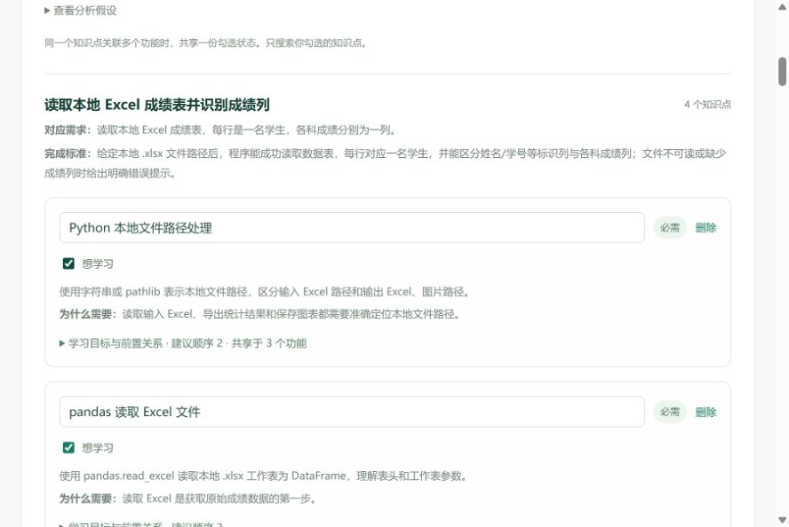
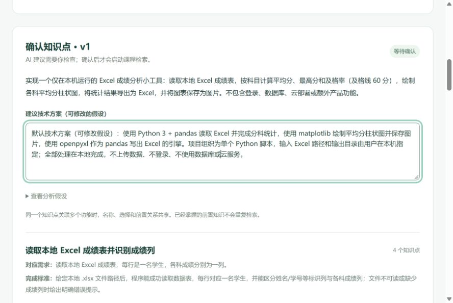
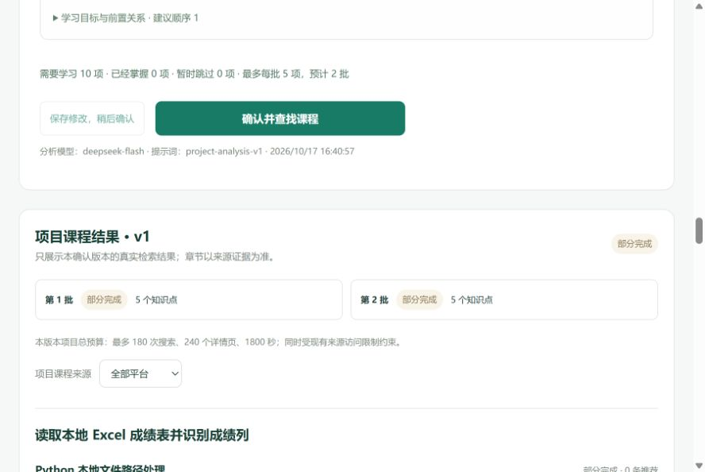
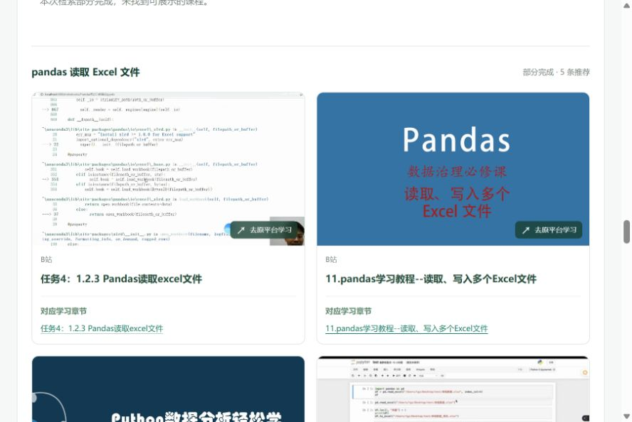

# DeepSeek 真实项目闭环验收（2026-10-17）

本阶段接续项目分析 v1，使用用户本轮提供的 DeepSeek API Key。凭据仅写入被 Git 忽略的本机服务端 `.env`；报告、前端和测试不保存密钥。`.env.pre-deepseek-20261017` 是本机回退副本，同样被忽略。

## 最终结果

**真实流程已打通；课程覆盖仍为部分完成。当前不缺额外配置。**

实际页面：[打开本轮项目结果](http://127.0.0.1:18119/?project=df08803b-9bea-4ac7-92d1-59a1874c1695&version=1)。18119 已读取新的模型配置，使用本轮独立空库产生的持久化记录；没有把旧端口的缓存或结果复制进来。其他原有进程保持原样，不会热加载新的 `.env`。

| 阶段 | 实际结果 |
| --- | --- |
| 真实模型 | deepseek-flash，一次分析生成5功能/10点；全部模型调用13次=分析1、扩词10、重排2，均HTTP 200、stop；总用量15,397 tokens |
| 确认与分批 | 页面确认v1全10点，5+5两批；服务端未确认拒绝、刷新恢复、重复确认不建新任务均实测 |
| 真实搜课与抓取 | 两批共24次搜索、24个详情处理，66条资源记录中21条实际抓取成功，去重21个URL；搜索/详情缓存命中均0 |
| 真实章节 | 332条目录记录与来源证据逐字段一致，0不一致；这些是后台目录总数，不是332条推荐，也不表示逐个章节已播放 |
| 页面展示 | 按功能/知识点显示12卡：9条支持、3条部分匹配；2个知识点有支持资源，另1个只有部分匹配，7个暂无可展示课程 |
| 终态与边界 | 项目和两批均partial，保留预算耗尽及来源警告。流程验收通过，不代表完整教学覆盖或全平台覆盖 |

只读核验全部通过：[汇总](acceptance-summary.json)、[章节账本](chapter-ledger.json)、[全局审计](audit-status.json)。UI独立核验：[最终页面检查](ui/final-verification.json)，无控制台错误/警告、框架错误浮层或横向溢出，刷新恢复同一版本与结果。封面采用懒加载，滚动后的可见封面均已正常加载。

## 配置

- `LLM_PROVIDER=openai_compatible`
- `LLM_BASE_URL=https://api.deepseek.com`
- `LLM_MODEL=deepseek-flash`
- `/models` 认证检查 HTTP 200，返回 deepseek-flash 与 deepseek-v4-pro；选择前者。
- 只修改上述三个字段及 `LLM_API_KEY`；搜索源、来源限制、抓取设置、各项预算和本地监听范围保持原样。[配置检查](configuration-check.json)
- JSON 调用格式参照 [DeepSeek 官方 JSON 文档](https://api-docs.deepseek.com/guides/json_mode/)。模型名称以账号当时可用列表为准。

## 验收范围

在新的空 SQLite 数据库和本地端口 18119 操作真实页面：项目输入 → DeepSeek 分析 → 人工审阅输出并在确认界面确认 → 原 JobService 分批真实搜索与页面抓取 → 项目页显示真实资源。没有 Mock 模型、固定课程链接、种子候选或旧搜索任务；模型和抓取证据分别记录，结构校验通过不替代教学内容审核。

本阶段记录将保留异常与部分结果，完整度以最终任务状态和逐知识点结果为准。

## 已实际执行的模型与确认步骤

1. 在真实页面输入“Excel 成绩分析工具”及本地读表、均值/最高分/60 分及格率、柱状图、Excel 与 PNG 导出需求。
2. DeepSeek 单次分析 HTTP 200、`finish_reason=stop`，耗时约 28.29 秒；生成 5 个功能与 10 个知识点，结构校验一次通过，没有修正重试。[实际分析](analyzed-v1.json)、[模型响应审计](live/model-events.jsonl)
3. 人工审阅读表、统计、绘图、导出覆盖完整，采用单一可修改方案；未加入登录、数据库、云部署或虚构课程。10 点对初学者可接受。确认时接受 `.xlsx` 首表、无效成绩排除且有效成绩作分母、PNG 等明确假设。[内容审阅](analysis-review.md)
4. 未确认时服务端真实返回 HTTP 409，尚无批次。随后代理按用户授权扮演验收学生，在页面点击“确认并查找课程”；这是验收操作，不表示用户本人逐项声明掌握程度。
5. 全部 10 点选择“需要学习”，生成 5+5 两批。刷新页面并重复点击确认，快照、批次 ID 和首个任务 ID 均不变，无重复任务。[确认快照](confirmed-v1.json)、[幂等复查](refresh-and-idempotency.json)

## 代码补强与离线回归

- 共用模型传输拒绝明确 `length` 截断和非正常结束；配置密钥回显被拦截，不能进入知识点或外部搜索关键词。
- `partial` 终态但没有课程时显示真实空态，平台筛选无匹配单独提示；暂时轮询失败后恢复会清除旧读取错误，仍保留确认等操作错误。
- 验收 runner 增加只读模型调用观察：仅保存时间、HTTP 状态、响应 ID、模型名、token 用量、结束原因和响应哈希；不保存请求头、密钥、模型原始响应正文。观察失败标记验收无效，不能覆盖真实服务结果。

| 实际执行 | 结果 | 证据 |
| --- | --- | --- |
| 后端完整 `tests backend/tests` | 1124 passed + 26 subtests；1 个原有 Starlette 弃用警告 | [JUnit](backend-final.xml)、`backend-final.log` |
| 前端逻辑 | 34/34 | `frontend/node-tests.log` |
| TypeScript/Vite | 构建通过；勾选简化后再次通过 | `frontend/build.log`、`checkbox-ui/build.log` |
| Edge 全量 E2E | 原轮 40/40；勾选简化后最终 41/41 | [原轮结果](frontend/e2e-results.json)、[最终结果](checkbox-ui/e2e-results.json) |
| 观察器与分析专项 | 87 passed（包含在完整套件中，不累加） | [JUnit](model-observer-offline.xml) |

上述自动化测试采用明确标注的离线 Mock；本阶段真实联调使用空库、真实模型及真实搜索，证据独立。Browser plugin/skill 未提供，离线界面测试沿用仓库 Playwright/Edge；真实流程通过当前 in-app browser 实际操作。

## 抓取计数与限制

- 第一批：30条资源记录，12条fetched，309条章节；第二批：36条资源记录，9条fetched，23条章节。其他资源可能只含搜索证据或访问失败，不能都称为已抓取课程。
- 观察到28个HTTP响应记录：3个robots响应、25个page响应均为200；发现页也计入page，因此不能把HTTP响应次数等同课程数。21个fetched资源均有本轮HTTP依据。
- 每批原上限仍为5知识点、12次搜索、12个详情页、240秒；两批预留24/24，项目上限180/240。没有扩大预算、绕过访问限制或偷偷重试以补齐覆盖。
- 流程没有缺模型配置；本轮结果缺口是资源发现、详情预算和内容证据不足。7个点保留明确空态，不把未核实候选升级为推荐。未验证完整视频播放或课程教学质量。
- 模型假设可修改；有效成绩为空时的分母规则、环境依赖安装和友好报错等实际项目实现细节仍须明确。此任务是分析与找课，不是代写成绩分析工具。
- 汇总器首次严格比较审计导出与数据库时，因既有审计主动删除URL查询参数而误报两处；按原脱敏契约归一化后通过。原始数据库、HTTP事件和章节原始链接未改，没有重跑真实请求；未重建文件冒充首轮摘要。

## 启动、复核与交付文件

常规启动（读取本机模型配置；使用原常规数据库）：

```powershell
cd D:\项目制知识引导小精灵
.\scripts\start.ps1 -SkipInstall -NoBuild
```

当前18119已运行，无需重复启动。进程退出后恢复本轮项目记录：

```powershell
.\.venv\Scripts\python.exe scripts/serve_project_acceptance.py --resume --port 18119 --output reports/project-deepseek-live-20261017/live
```

只读重算本轮核验（不发送模型或搜索请求）：

```powershell
.\.venv\Scripts\python.exe scripts/summarize_project_model_live.py
```

本阶段代码变更：`backend/app/llm.py`、`frontend/src/components/ProjectFlow.tsx`、`frontend/src/useProject.ts`、`frontend/src/projectTypes.ts`；回归测试：`tests/test_project_analysis.py`、新增`tests/test_project_model_observer.py`、`frontend/tests/project.spec.ts`；验收工具：`scripts/serve_project_acceptance.py`、新增`scripts/summarize_project_model_live.py`；文档：`README.md`、`docs/project-analysis-v1.md`及本目录。配置变更仅为本机忽略文件`.env`的4个模型字段。

已保存一致性数据库副本`live-evidence.sqlite3`并通过integrity_check；158个源码、前端构建、测试和本轮证据文件扫描未发现实际配置密钥。[安全与副本检查](credential-and-backup-check.json)。源码、构建和证据哈希见[交付清单](delivery-manifest.json)。不包含密钥文件。

## 页面证据

### 最新勾选界面调整

按用户最新要求，去掉“已经掌握 / 暂时跳过”三选项，只保留“想学习”复选框；点击“查找推荐视频”后仅搜索勾选知识点，全部取消时可“保存选择”且不创建空任务。后端仍兼容原有选择字段，旧 `mastered` 仅在可编辑草稿转换为未勾选，明确保存才生成新版本，不改写历史确认。

实际页面将共享知识点 k2 取消勾选后，3 处均同步取消，汇总为 9/1；前置影响提示出现且查找按钮需明确处理后才能使用。随后恢复原选择，3 处均勾选，汇总恢复 10/0。页面无旧选择文字、无选择单选框、无控制台警告或错误。[浏览器检查](checkbox-ui/browser-check.json)

此次 UI 调整没有再次提交分析、确认或搜索，也没有新建项目版本或任务；前述真实调用及课程证据保持原样。构建和全量 E2E 41/41 重新执行；后端未变，沿用此前完整后端回归。旧界面截图保留以对应真实流程发生时的状态，最新界面如下：



真实分析与方案：



确认后两批的最终状态：



实际课程封面、标题和来源章节：


