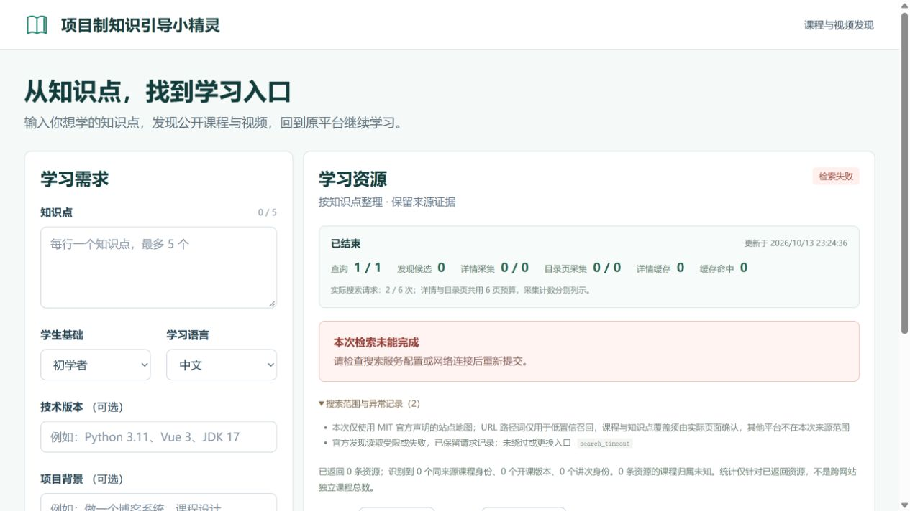

# 传输诊断与受控 JS 补全：实现及真实验证

日期：2026-10-13。结论：生产代码与隔离测试已完成；MIT 官方索引到课程目录、真实动态网页新增目录这两个成功链路仍未通过。本阶段有真实网络请求和保留的失败，不能把失败写成“未做联网”，也不能把离线通过写成真实源成功。

## B站、MOOC 的直接回答

- B站此前真实搜索发现了来源链接；普通浏览器样本 `BV1VZ4y1G7YB` 可见 15 个分集及对应时长。这只是浏览器观察，未导入应用的自动目录，也没有观察到成功推进的播放。保存截图为课程封面/缓冲状态，早期 JSON 中黑色占位描述的更正见 `../completion-20261013/evidence-errata.json`。
- 中国大学 MOOC 的 NWPU-1207119809 课程身份、介绍和大纲标题可见，但本次渲染未观察到大纲条目，原因 unknown；另一个早期 WHUT-1206307812 入口曾显示大纲和学期关闭/教师未开放访问提示。不能将两个页面的现象合并成整个平台可观看或没有目录。
- 自动读取策略分别标注：B站条款所需许可未取得；MOOC 自动采集许可范围待确认。普通浏览器能打开不自动改变这些边界。现有应用继续显示“仅搜索发现，页面详情未核验”。

证据：`../completion-20261013/bilibili-browser-check.json`、`mooc-browser-check.json`、`../browser-mooc-entry-20261013.json`，及原截图。原记录和原失败均保留。

## 已实现

- Fetcher 可切换分阶段期限与 HTTP 阶段诊断：TCP、TLS、响应头、正文空闲/总期限、完整/部分字节及哈希。部分响应不进入 XML 解析或成功缓存。
- 安全 Fetcher 到匿名离线 Edge 的生产补全。主文档真实声明的脚本/样式必须经过策略、robots、SSRF、固定公网 IP、原域名 TLS 和预算检查。仅入口允许名单及显式资产名单可用。
- 最多两轮离线执行。第一轮实际观察到的同源、无查询参数 `.md/.json` GET 最多读取两项；没有猜测 API、第三轮、浏览器 HTTP 回退或视频下载。
- 原 CSP 保留；请求、DoH、字节、时间及取消清理受限。每次渲染的补充请求预算不是整个任务的请求总数；本次真实脚本另有独立总计数器。
- 静态与动态证据分别留存。动态占位不能覆盖可靠静态字段；动态验证码/登录/拒绝状态不会被忽略。字段与章节标记 acquisition、render id、HTML/manifest/DOM hash。
- 默认开关、配置、页面缓存隔离、API 模型和前端来源说明已接入。明确区分离线执行完成、字段增益、课程结构和实际播放。
- 微软 AI curriculum 表提取器有严格 URL/课程说明/编号 Lesson Link 表条件；普通文档、菜单及其他域名不能升级为课程。其选择器只有隔离测试验证，当前没有真实 DOM 成功证据。

## 本阶段真实网络

| 验证 | 实际出站 | 结果 |
| --- | --- | --- |
| 微软课程入口探测 | 2 目标 HTTP + 4 DoH | 主文档 200、875 字节，静态章节 0；确认真实脚本/样式引用 |
| MIT 单点 probability，最多 1 子索引 | 2 目标 HTTP + 4 DoH；18.677 秒 | robots 200；根 XML 200，约 1.230 秒收到头，读到 259803 字节后触发正文总期限 10 秒。未完整、未解析，0 候选/课程/目录 |
| 微软课程生产 JS 入口验证 | 3 目标 HTTP + 6 DoH；14.046 秒 | 主文档 200；声明 CDN 的 robots 返回 400（58 字节），Fetcher's `robots_unavailable` 停止。脚本未获取、Edge 未启动、动态章节 0 |

请求严格串行，无重试、替换课程或覆盖旧记录。MIT 本次有足够诊断确认 `body_total`；更早统一 10 秒失败缺阶段证据，仍为 unknown，不能追溯填成同一原因。代码在两次正式执行前后哈希一致。入口探测/官方文档查阅属于准备阶段，不是上述单次正式验证预算，也不计为搜索成功。

原始报告：`../completion-20261013/mit-transport-revision-live.json`、`dynamic-course-live.json`、`dynamic-entry-probe.json`。各自 scope 和原始响应一并保存。直接课程入口验证没有执行搜索，不属于独立留出集，也没有进入正式搜索数据库。

## 测试与页面验证

- 最终后端 **447 passed + 26 subtests passed**，42.91 秒；一条既有 Starlette/httpx 弃用提示。首次全套中的旧适配器注册表断言已随新增适配器更新，首次失败报告保留，随后全套复跑通过。
- 其中生产 renderer 的 **26 项隔离检查**包含系统 Edge 两轮读取、原 CSP、未知依赖、预算、运行中取消及不读取 stdin 时的有界清理。它们包含固定测试数据，不算真实动态目录成功。
- 前端构建成功；相关 Edge E2E **5 项通过**，无运行异常、控制台异常或意外请求。覆盖桌面与移动布局、动态字段证据、配置开关。它们不与历史 28 项简单相加。
- 真实应用 `127.0.0.1:8000` 加载非空；展开能力说明可见在线回退关闭、受控 JS 默认关闭及预算。真实 MIT 失败数据库在临时 `8001` 通过生产 API/UI 显示 failed、0 候选及 search_timeout，异常记录展开正常，控制台无错误；临时实例已停止。

证据：`backend-all-final.xml`、`rendering-cleanup-check.xml`、`render-integration.xml`、`adapter-regression-final.xml`、`live-ui-check.json`；前端报告为 `../completion-20261013/frontend-render-qa.md`。

## 当前运行与边界

已更新主应用为隐藏后台单工作进程，监听 `127.0.0.1:8000`；启动命令退出后，两次独立检查 health 正常，最终只有该端口实例。SearXNG、现有 12 次搜索/12 页详情/240 秒任务预算及并发 1 保持原配置；MIT 回退、JS 补全默认关闭，按 `.env.example` 可切换，未将失败实测源伪装为可用。没有新增系统服务、开机任务、账号、凭据或依赖版本变更。

全部浏览器后代进程退出、操作系统后台与 UDP 出口隔离仍为 unknown。已验证的是页面 HTTP 的预审字节回放和拥有进程的有界清理。当前实现不能声称任意动态页面或 B站/MOOC 自动目录已通过真实验收。

