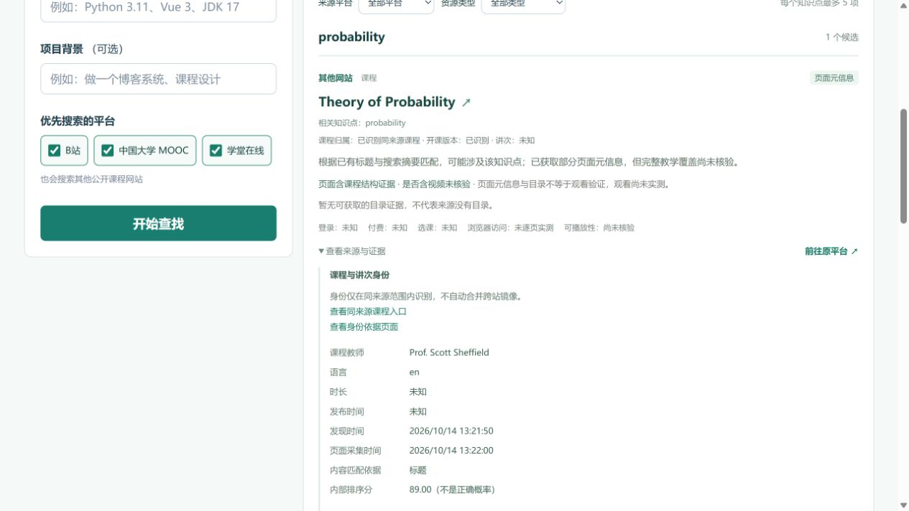
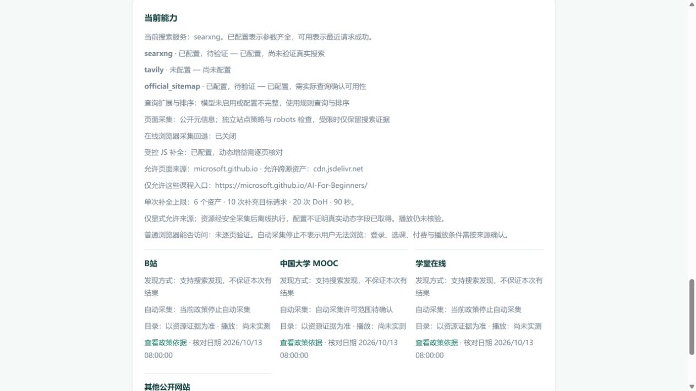

# 2026-10-14 真实联网验收与剩余边界

## 对 B站、MOOC 问题的直接结论

两站没有完成“真实搜索→应用自动提取目录→展示与播放核验”的全链验收。之前取得了搜索链接及浏览器观测，不能将其算作自动目录成功。当前应用明确显示“仅搜索发现，页面详情未核验”。

- **B站**：2026-10-13 浏览器样本 `BV1VZ4y1G7YB` 可见 15 个分集标题/时长，但未写入生产目录，未观察到播放进度推进。当前项目策略依据已记录的平台协议停止直接自动采集。浏览器能打开不代表程序自动采集已通过。
- **MOOC**：`NWPU-1207119809` 可见课程身份和大纲标题，当次可见大纲条目为 0，原因 unknown；不代表来源没有目录。另一个历史入口有不同大纲/课程关闭状态。项目自动采集许可范围仍待确认，未通过自动目录或播放验收。
- 原始记录保留在 `../completion-20261013/bilibili-browser-check.json`、`mooc-browser-check.json` 和 `evidence-errata.json`。B站旧 JSON 中截图状态的表述已有单独勘误，没有覆盖原件。

## 本次实际联网结果

| 独立批次 | 目标 HTTP / DoH / 搜索端点 HTTP | 真实结果 | 未证明事项 |
|---|---:|---|---|
| MIT 新期限验证 | 4 / 8 / 0 | robots→根索引→实际子索引→Theory of Probability 课程主页；真实 API 返回 1 项 | 目录 0；无视频结构或播放证据 |
| Microsoft 英文标题搜索 | 0 / 0 / 3 | 三次真实 SearXNG/Bing 查询，返回字典/电影等；最终课程结果 0 | 未执行 JS，不是动态补全测试 |
| Microsoft 课程标识搜索 | 0 / 0 / 3 | 原课程标识的限定开发验证，仍返回泛 AI 结果，课程结果 0；停止继续试查询变体 | 同上；不是独立留出集 |
| Microsoft 直接组件验证（修复前） | 7 / 14 / 0 | 读取真实 HTML、CSS、JS、README；首轮离线失败触发的 `_404.md` 返回 404，停在 render_asset_rejected | 失败原件完整保留 |
| Microsoft 直接组件验证（修复后） | 6 / 12 / 0 | 相同入口静态目录 0，真实页面脚本离线执行后 28 个课程目录链接，2 轮 | 不是搜索发现/API 任务结果，不证明视频或播放 |

所有批次使用新 scope、新输出、新数据库或独立内存存储。搜索与目标、DoH 均独立计数，已观察最大并发为 1，未重试或替换访问受限来源。表中“搜索端点”指本机已配置 SearXNG；SearXNG 内部上游 HTTP 总数 unknown，不将表中数字冒充全部互联网请求数。

MIT 根 XML 本次完整读取 **363036 字节**，正文约 **10.897 秒**；根据本次 Content-Length 计算的正文额度约 **27.158 秒**。旧 10 秒正文失败是本地期限问题；更早没有阶段遥测的失败原因仍 unknown。没有将旧 XML 导入生产发现。

28 个目录链接来自同一课程的 26 个数字目录行（含准备和扩展，部分行有两个链接），不是 28 门课或 28 个视频。逐条 `evidence_id`、`chapters.N`、标题、URL、输入/清单/DOM 哈希 **28/28 对应**。本批 28 条直接验证结果未插入正式搜索数据库。

原始证据：`mit-live.json`、`dynamic-live.json`、`dynamic-course-id-live.json`、`dynamic-direct/dynamic-course-live.json`、`dynamic-cascade/dynamic-course-live.json`，以及对应 scope、原始响应、SQLite。每次执行前后源码哈希一致，先前失败报告哈希一致。之后收窄的最终策略用相同已保存字节离线回归，见 `dynamic-final-subtree-offline.json`；不伪称最终版本又做了一次外网测试。

## 修复与安全范围

1. 正文期限按本次合法长度/字节上限与最低速率计算，受请求硬上限和任务剩余时间约束；不随分块延长。统一任务绝对期限覆盖 DNS、等待和 HTTP。任务期限耗尽不会永久锁死下一任务的官方来源。
2. jsDelivr robots 400 只接受已核实的纯文本路由错误，且必须初始来源相同、无跳转、无 Retry-After 或认证挑战；其他拒绝、验证码和站点许可判断不变。
3. MIT 已观察到的可选统计/反馈脚本仅精确 GET script 路径可非致命阻止，零预取、零浏览器网络；POST、导航、其他路径和原 CSP 仍阻止且失败。
4. 首轮仅补取第一个实际观察到的同源 GET 文本依赖，再做最终第二轮，避免离线阻断造成的备用 404 连锁失败。关键首轮错误不能由第二轮成功覆盖。
5. 新增精确入口限制，入口及同源资源/重定向只允许该课程目录子树；已声明 CDN 资产另按原规则核验。缓存策略版本隔离旧失败/宽范围配置。

## 搜索缺口与证据勘误

只读本机容器复核了六次完整查询、原始 JSON 回显和官方 Bing 引擎构造。没有本地截词/编码错误证据；两组各三次结果相同，站点限定结果均不匹配。真实 Bing 出站请求、重定向及原始 HTML 没有记录，不能断言某个上游机制是根因。当前结论是这些查询的**实际搜索覆盖失败**，不是 JS 被外部禁止。见 `bing-query-readonly-review.md`。

旧 `rendered-dom.html` 保存时 Windows 将 LF 转为 CRLF，物理文件哈希与逻辑 DOM 文本哈希不同。原件保留，另存 UTF-8 LF 精确副本并核对，见 `dom-evidence-errata.json`。不要直接将原件物理哈希写成诊断 DOM 哈希。

本批已执行的冻结开发 runner 留有未触发的压缩响应前置检查及异常收尾缺陷，不能当通用验收工具复用；本次六份搜索均已通过生产 identity 编码检查并正常收尾。详细范围见 `runner-readonly-review.md`。该缺陷不在应用生产搜索传输代码中。

## 最终测试、界面与运行

- 冻结代码全量后端：**492 passed + 26 subtests passed**，`backend-frozen-final.xml`；一条既有 Starlette/httpx 弃用提示。之前 474/486 是较早代码版本，不与最终计数相加。
- 前端 TypeScript/Vite 构建通过；相关 Edge 配置用例 **1 passed**，与此前历史 28 项不相加。生产页面另检查了真实 MIT 结果、真实零命中搜索记录、最终精确入口能力说明；非空、无框架错误覆盖层，控制台 error/warn 为空，展开交互正常。浏览器为 Codex IAB，桌面视口约 1265×713；本轮未新验移动布局。
- 本机 `http://127.0.0.1:8000` 已以隐藏后台、单 worker 运行最终配置。SearXNG、并发 1、12 搜索/12 详情/240 秒任务预算保持；MIT 官方回退开启，受控 JS 仅允许 `https://microsoft.github.io/AI-For-Beginners/` 及其课程子树，跨源仅允许该入口实际声明的 jsDelivr 资产。默认模板仍关闭可选功能。最终 renderer profile 为 5。
- 传输启用分阶段期限：首响应 10 秒、idle 5 秒、最低速率 16384 B/s、正文 cap 30 秒。无需新账号或付费服务。
- 最后路径收窄后再次更新了后台实例；更新前均确认无 queued/running 任务，未注入验证结果。临时 8001 预览已停止。两次独立健康检查均通过，见 `runtime-final-check-1.json`、`runtime-final-check-2.json`。没有新增系统服务或开机项。

未完成：B站/MOOC 应用内自动目录、Microsoft 搜索到动态课程的完整链路、视频播放、任意动态站点支持、操作系统所有浏览器后台/UDP 出口及全部子进程退出的完整证明。当前不可声称“全平台真实验收通过”。

